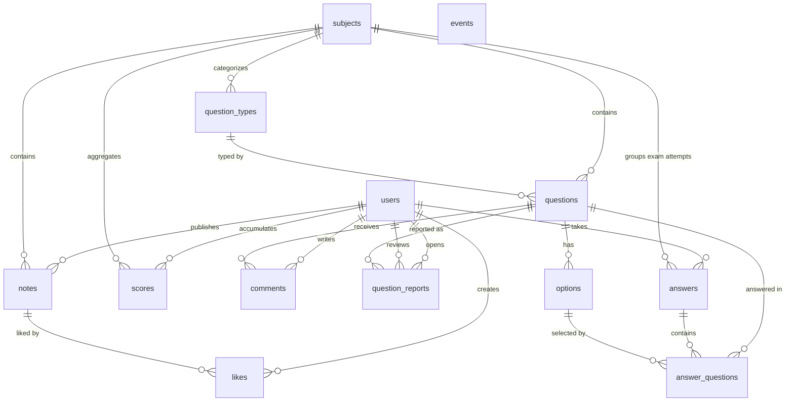

# Database Schema Documentation

This document reflects the Lucid migrations in [`database/migrations/`](../database/migrations) and the ORM models in [`app/models/`](../app/models).

## Overview

- Database engine: PostgreSQL
- ORM: Lucid ORM
- Migration entry point: `node ace migration:run`
- Core domains:
  - local user ownership and AuthNEI account resolution
  - subjects, question types, questions, and options
  - exams, answers, and score aggregation
  - collaborative content through comments, notes, likes, and question reports
  - admin-managed events

## Entity Relationship Diagram

## Tables

### `users`

Primary local ownership table used by auth middleware and all user-owned resources. AuthNEI is the
source of truth for identity and roles. `name`, `email`, and `email_verified_at` are synchronized
caches retained for lookup, search, and account resolution; they never grant authorization.

| Column              | Type         | Null | Constraints / Notes                       |
| ------------------- | ------------ | ---- | ----------------------------------------- |
| `id`                | serial       | no   | primary key                               |
| `name`              | varchar      | no   | synchronized AuthNEI display-name cache   |
| `email`             | varchar(254) | no   | unique synchronized AuthNEI lookup cache  |
| `email_verified_at` | timestamp    | yes  | synchronized AuthNEI verification cache   |
| `auth_subject`      | varchar(255) | yes  | unique nullable identity-provider subject |
| `created_at`        | timestamp    | no   |                                           |
| `updated_at`        | timestamp    | no   |                                           |

Relations:

- one-to-many with `answers`
- one-to-many with `scores`
- one-to-many with `comments`
- one-to-many with `notes`
- one-to-many with `likes`
- one-to-many with `question_reports` as reporter
- one-to-many with `question_reports` as reviewer via `reviewed_by`

### `subjects`

Top-level academic subject catalog.

| Column       | Type      | Null | Constraints / Notes          |
| ------------ | --------- | ---- | ---------------------------- |
| `id`         | serial    | no   | primary key                  |
| `name`       | varchar   | no   | subject label                |
| `slug`       | varchar   | no   | used by exam rule resolution |
| `year`       | integer   | no   | catalog year                 |
| `created_at` | timestamp | no   |                              |
| `updated_at` | timestamp | no   |                              |

Relations:

- one-to-many with `question_types`
- one-to-many with `questions`
- one-to-many with `answers`
- one-to-many with `scores`
- one-to-many with `notes`

### `question_types`

Question taxonomy scoped to a subject.

| Column       | Type      | Null | Constraints / Notes                      |
| ------------ | --------- | ---- | ---------------------------------------- |
| `id`         | serial    | no   | primary key                              |
| `name`       | varchar   | no   | type label                               |
| `subject_id` | integer   | no   | FK -> `subjects.id`, `ON DELETE CASCADE` |
| `created_at` | timestamp | no   |                                          |
| `updated_at` | timestamp | no   |                                          |

### `questions`

Question bank entries shown in generated exams.

| Column             | Type        | Null | Constraints / Notes                                                                                       |
| ------------------ | ----------- | ---- | --------------------------------------------------------------------------------------------------------- |
| `id`               | serial      | no   | primary key                                                                                               |
| `question`         | varchar     | no   | question prompt                                                                                           |
| `image`            | varchar     | no   | image URL or asset reference; required by schema                                                          |
| `correct_option`   | varchar(1)  | no   | application expects a single option order such as `A`                                                     |
| `exam`             | varchar     | no   | source exam identifier                                                                                    |
| `source`           | varchar(20) | no   | provenance; default `REAL_EXAM`; check `questions_source_allowed` (`REAL_EXAM`, `AI_GENERATED`, `MANUAL`) |
| `subject_id`       | integer     | no   | FK -> `subjects.id`, `ON DELETE CASCADE`                                                                  |
| `question_type_id` | integer     | no   | FK -> `question_types.id`, `ON DELETE CASCADE`                                                            |
| `created_at`       | timestamp   | no   |                                                                                                           |
| `updated_at`       | timestamp   | no   |                                                                                                           |

Relations:

- many-to-one with `subjects`
- many-to-one with `question_types`
- one-to-many with `options`
- one-to-many with `comments`
- one-to-many with `question_reports`
- one-to-many with `answer_questions`

### `options`

Possible answers for a question.

| Column        | Type       | Null | Constraints / Notes                        |
| ------------- | ---------- | ---- | ------------------------------------------ |
| `id`          | serial     | no   | primary key                                |
| `name`        | varchar    | no   | option text                                |
| `order`       | varchar(1) | no   | canonical choice key such as `A`, `B`, `C` |
| `question_id` | integer    | no   | FK -> `questions.id`, `ON DELETE CASCADE`  |
| `created_at`  | timestamp  | no   |                                            |
| `updated_at`  | timestamp  | no   |                                            |

Relations:

- many-to-one with `questions`
- one-to-many with `answer_questions`

### `answers`

Stores each submitted exam attempt.

| Column       | Type      | Null | Constraints / Notes                                                                      |
| ------------ | --------- | ---- | ---------------------------------------------------------------------------------------- |
| `id`         | serial    | no   | primary key                                                                              |
| `score`      | integer   | no   | persisted rounded exam score                                                             |
| `user_id`    | integer   | yes  | FK -> `users.id`, `ON DELETE SET NULL`                                                   |
| `subject_id` | integer   | no   | FK -> `subjects.id`, `ON DELETE CASCADE`                                                 |
| `mode`       | varchar   | no   | default `random`; API also uses `default`, `realistic`, `new`, `wrong`, `hard`, `custom` |
| `time`       | integer   | yes  | optional completion time, check constraint `time >= 0`                                   |
| `created_at` | timestamp | no   |                                                                                          |
| `updated_at` | timestamp | no   |                                                                                          |

Relations:

- many-to-one with `users`
- many-to-one with `subjects`
- one-to-many with `answer_questions`

### `answer_questions`

Per-question detail for an exam attempt.

| Column        | Type      | Null | Constraints / Notes                                             |
| ------------- | --------- | ---- | --------------------------------------------------------------- |
| `id`          | serial    | no   | primary key                                                     |
| `answer_id`   | integer   | no   | FK -> `answers.id`, `ON DELETE CASCADE`                         |
| `question_id` | integer   | no   | FK -> `questions.id`, `ON DELETE CASCADE`                       |
| `option_id`   | integer   | yes  | FK -> `options.id`, `ON DELETE SET NULL`; null means unanswered |
| `is_wrong`    | boolean   | no   | default `true`                                                  |
| `created_at`  | timestamp | no   |                                                                 |
| `updated_at`  | timestamp | no   |                                                                 |

Additional constraints:

- unique composite key on `answer_id, question_id`

### `comments`

User comments attached to questions.

| Column        | Type      | Null | Constraints / Notes                       |
| ------------- | --------- | ---- | ----------------------------------------- |
| `id`          | serial    | no   | primary key                               |
| `comment`     | text      | no   | free-form comment body                    |
| `user_id`     | integer   | no   | FK -> `users.id`, `ON DELETE CASCADE`     |
| `question_id` | integer   | no   | FK -> `questions.id`, `ON DELETE CASCADE` |
| `created_at`  | timestamp | no   |                                           |
| `updated_at`  | timestamp | no   |                                           |

### `scores`

Aggregated scoreboard totals per user and subject.

| Column            | Type      | Null | Constraints / Notes                      |
| ----------------- | --------- | ---- | ---------------------------------------- |
| `id`              | serial    | no   | primary key                              |
| `score`           | integer   | no   | cumulative score total                   |
| `user_id`         | integer   | no   | FK -> `users.id`, `ON DELETE CASCADE`    |
| `subject_id`      | integer   | no   | FK -> `subjects.id`, `ON DELETE CASCADE` |
| `show_scoreboard` | boolean   | no   | default `true`                           |
| `created_at`      | timestamp | no   |                                          |
| `updated_at`      | timestamp | no   |                                          |

Additional constraints:

- unique composite key on `user_id, subject_id`

### `question_reports`

Tracks user reports about problematic questions.

| Column        | Type      | Null | Constraints / Notes                       |
| ------------- | --------- | ---- | ----------------------------------------- |
| `id`          | serial    | no   | primary key                               |
| `reason`      | text      | yes  | optional report reason                    |
| `question_id` | integer   | no   | FK -> `questions.id`, `ON DELETE CASCADE` |
| `user_id`     | integer   | no   | FK -> `users.id`, `ON DELETE CASCADE`     |
| `reviewed_at` | datetime  | yes  | review timestamp                          |
| `reviewed_by` | integer   | yes  | FK -> `users.id`, `ON DELETE SET NULL`    |
| `solved`      | boolean   | no   | default `false`                           |
| `created_at`  | timestamp | no   |                                           |
| `updated_at`  | timestamp | no   |                                           |

Additional constraints:

- unique composite key on `question_id, user_id`

### `notes`

Study materials attached to a subject.

| Column        | Type      | Null | Constraints / Notes                          |
| ------------- | --------- | ---- | -------------------------------------------- |
| `id`          | serial    | no   | primary key                                  |
| `title`       | varchar   | no   | note title                                   |
| `url`         | text      | yes  | direct URL when content is externally hosted |
| `description` | varchar   | yes  | short description                            |
| `views`       | integer   | no   | default `0`                                  |
| `n_pages`     | integer   | yes  | optional page count                          |
| `upload_id`   | varchar   | yes  | private S3 object identifier                 |
| `user_id`     | integer   | no   | FK -> `users.id`, `ON DELETE CASCADE`        |
| `subject_id`  | integer   | no   | FK -> `subjects.id`, `ON DELETE CASCADE`     |
| `created_at`  | timestamp | no   |                                              |
| `updated_at`  | timestamp | no   |                                              |

Relations:

- many-to-one with `users`
- many-to-one with `subjects`
- one-to-many with `likes`

### `likes`

User likes on notes.

| Column       | Type      | Null | Constraints / Notes                   |
| ------------ | --------- | ---- | ------------------------------------- |
| `id`         | serial    | no   | primary key                           |
| `user_id`    | integer   | no   | FK -> `users.id`, `ON DELETE CASCADE` |
| `note_id`    | integer   | no   | FK -> `notes.id`, `ON DELETE CASCADE` |
| `created_at` | timestamp | no   |                                       |
| `updated_at` | timestamp | no   |                                       |

Additional constraints:

- unique composite key on `user_id, note_id`

### `events`

Admin-managed event windows shown in the Antirecurso dashboard.

| Column        | Type      | Null | Constraints / Notes            |
| ------------- | --------- | ---- | ------------------------------ |
| `id`          | serial    | no   | primary key                    |
| `name`        | varchar   | no   | event title                    |
| `description` | text      | yes  | optional long-form description |
| `start_date`  | date      | no   | serialized as `YYYY-MM-DD`     |
| `end_date`    | date      | no   | serialized as `YYYY-MM-DD`     |
| `created_at`  | timestamp | no   |                                |
| `updated_at`  | timestamp | no   |                                |

### `exam_attempts`

Immutable stored generation and committed grading/replay data. Client UUIDs are scoped to the owner; internal row IDs are used for ORM updates.

| Column | Type | Null | Constraints / Notes |
| ------ | ---- | ---- | ------------------- |
| `row_id` | serial | no | primary key |
| `id` | uuid | no | unique with `user_id`; external attempt ID |
| `user_id` | integer | no | FK -> `users.id`, `ON DELETE CASCADE` |
| `subject_id` | integer | no | FK -> `subjects.id`, `ON DELETE CASCADE` |
| `mode` | varchar | no | validated exam mode |
| `snapshot` | jsonb | no | original questions/options/configuration; optional committed per-question grading |
| `request_hash` | varchar(64) | yes | SHA-256 normalized verification request |
| `result` | jsonb | yes | exact committed result; null means unfinished |
| `created_at` | timestamp | no | |
| `updated_at` | timestamp | no | |

Unique `(user_id, id)`; owner/result expression index `(user_id, (result->>'id'))`; partial owner index where `result IS NULL`. Generation caps unfinished rows at 20 per owner; explicit owned discard removes unfinished rows, while completed history/replay is retained.

### `exam_states`

Current cloud progress for each owner, subject and mode.

| Column | Type | Null | Constraints / Notes |
| ------ | ---- | ---- | ------------------- |
| `id` | serial | no | primary key |
| `user_id` | integer | no | FK -> `users.id`, `ON DELETE CASCADE` |
| `subject_id` | integer | no | FK -> `subjects.id`, `ON DELETE CASCADE` |
| `mode` | varchar | no | validated exam mode |
| `state` | jsonb | no | bounded validated saved progress |
| `is_completed` | boolean | no | default false |
| `revision` | integer | no | default 1; incremented on saves |
| `attempt_id` | uuid | yes | composite FK `(user_id, attempt_id)` -> `exam_attempts(user_id, id)`, `ON DELETE CASCADE` |
| `created_at` | timestamp | yes | ORM fills on creation |
| `updated_at` | timestamp | yes | ORM updates on save |

Unique `(user_id, subject_id, mode)`; `attempt_id` index supports associations/cascades. CAS uses row ID/revision. Saved question order is preserved because `currentQuestionIndex` refers to that sequence. Legacy verification cannot write scores for an unfinished attempt-bound state without its attempt ID. Completed state does not block a new legacy exam.

## Mobile safety migration

`1791594000000_add_mobile_account_safety.ts` adds:

- `comments.hidden_at`: nullable moderation timestamp, filtered from all user-facing comment reads.
- `user_blocks`: composite primary key `(user_id, blocked_user_id)`, both user FKs cascade; self-block check.
- `comment_reports`: comment/reporter FKs cascade, unique pair, bounded validated reason, `pending`/`dismissed`/`removed` status check, creation/review times and nullable reviewer FK (`SET NULL`). Indexed pending queue.
- `deleted_accounts`: SHA-256 issuer/subject hash primary key plus issued-at cutoff; minimal token invalidation metadata survives local-profile deletion.
- `note_uploads`: UUID grant primary key, authenticated owner FK (`CASCADE`) and creation timestamp. Existing orphan objects cannot be backfilled without ownership evidence.

[Deletion/moderation behavior and rollout](MOBILE_SAFETY.md). This additive migration is independent of the exam-recovery migration; install both before the updated mobile client.

Migration `1791792100000_index_mobile_safety_owners.ts` adds indexes for `note_uploads.user_id`/`created_at`, `comment_reports.reporter_id` and `user_blocks.blocked_user_id` for cleanup and reverse cascades. Upload ownership rows remain a cleanup ledger after promotion; age alone is not grounds to remove them.

## Foreign Key Deletion Behavior

The current schema uses these deletion rules:

- `ON DELETE CASCADE`
  - deleting a subject removes its question types, questions, answers, scores, and notes
  - deleting a question removes its options, comments, reports, and answer detail rows
- deleting a user removes comments, notes, likes, scores, and reports opened by the user
- `ON DELETE SET NULL`
  - `answers.user_id` is preserved if the user row is deleted
  - `answer_questions.option_id` is preserved as null if the option is deleted
  - `question_reports.reviewed_by` becomes null if the reviewer user is deleted

## Application-Level Invariants

Some important rules are enforced in application code rather than by database constraints:

- `questions.correct_option` should match one of the related `options.order` values
- `options.order` is treated as a single-character answer key
- exam payload validation requires a fixed number of answers based on exam mode
- `scores.score` is cumulative and updated transactionally after authenticated exam verification
- notes can resolve their content either from `url` or from `upload_id`; the schema does not require exactly one of them
- events must satisfy `end_date >= start_date`

## Immutable attempt recovery and cloud revisions

Migration `1791590400000_add_exam_attempt_recovery` adds `exam_attempts`: UUID primary key, nullable owner FK (`users`, cascade), subject FK (`subjects`, cascade), mode, immutable JSONB snapshot, nullable SHA-256 request hash, nullable JSONB exact result, and timestamps. Internal snapshots contain original options/IDs/correct choices and custom configuration. On completion, optional `grading` stores `{ questionId, optionId, isWrong }` for every submitted question in the same transaction as the result, with no live question/option FKs. Completed review enumerates snapshot questions in generation order; canonical deletion cannot erase recorded selections/grading. Pre-fix completed snapshots have no grading array and use the existing answer-detail fallback; no historical reconstruction/backfill is claimed. No extra migration is required for the JSONB field; public recovery strips correct choices, internal IDs and grading. Result and grading commit under an attempt-row lock. Authenticated writes first lock the owner to serialize state creation and scoreboard changes.

`exam_states` gains integer `revision` (default 1) and nullable `attempt_id` FK (`exam_attempts`, cascade). Saves increment revision; CAS checks revision and state ID. Absence/completion uses expected revision zero. Explicit completed restart increments the existing row's revision; delete supports the same CAS. Older clients remain compatible and gain guarantees when they adopt the optional fields.

Original content cannot be reconstructed retroactively. Removed underlying questions/options retain existing FK behavior and may invalidate ungraded attempts; never substitute new questions. Retention/cleanup policy remains API #83; no destructive backfill or production migration is included.

Migration `1791792000000_index_exam_attempt_recovery.ts` indexes `exam_states.attempt_id` and the composite owner/result expression `(user_id, (result->>'id'))` used for owned review and owner cascades. New snapshot writes and recovery require auth. The later owner-scope migration requires a non-null owner. Abandoned attempt/state retention remains a rollout requirement under #83; no cleanup scheduler is introduced here.

Migration `1791936000000_scope_exam_attempts_to_owner.ts` adds an internal `row_id` serial primary key, makes `user_id` non-null, and replaces global UUID uniqueness with `(user_id, id)`. Lucid updates use `row_id`; external APIs retain the client UUID scoped to authenticated owner. `exam_states(user_id, attempt_id)` references the same owner/UUID pair with cascade deletion. A partial owner index on `result IS NULL` supports the cap. Owner caps count only unfinished rows and serialize on the user row, alongside verification/account deletion.

This migration preserves owned snapshots and state associations. It intentionally fails transactionally if pre-existing anonymous snapshots or cross-owner state references need operator reconciliation; it does not delete or invent ownership. Rollback to global UUID uniqueness intentionally fails transactionally when duplicate UUIDs across owners exist; reconcile them and dependent state references first. No automated history cleanup or destructive reconciliation is run by the API. Owners can discard unfinished attempts, including those invalidated by canonical deletion; completed history is retained. Automated retention remains #83.

### Migration deployment constraints

The index migrations and owner-scope migration use transactional, non-concurrent index/constraint creation. Owner-scope preflight takes `ACCESS EXCLUSIVE` locks on `exam_attempts` and `exam_states` so diagnostics and key changes see the same rows. Preflight names up to 20 anonymous attempt IDs, mismatched/missing-owner state references, or duplicate rollback UUIDs and owners; it rejects the migration before key changes. No rows are deleted or assigned invented owners.

These migrations are suitable for empty/small tables during initial rollout, with API writes drained and a maintenance window. Rehearse timing/lock impact against staging row counts and take a backup before authorized production migration. They are not an online migration plan for large/live tables: use a separate reviewed deployment with concurrent indexes outside a transaction and staged constraint validation in that case. Committed Japa tests cover index apply/rollback/reapply, populated upgrades (including legacy null attempt references), preflight rejections and transactional data preservation.
